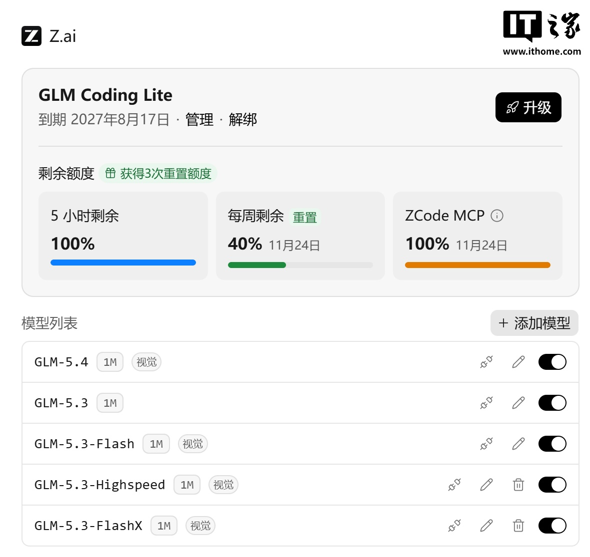

智谱官方运营人员发布消息，**GLM-5.4 模型已经上线 Coding Plan**。“过去三个月，我们同时激进的 Scaling Loop 和模型大小，大家首先看到的是 Loop Transformer 带来的惊喜。GLM-5.4 新增视觉能力与更强的泛 Coding 能力。”

此外，V2、V3 及团队版用户使用 GLM-5.4 模型额度已提升至 1.5 倍，**将模型名设置为 glm-5.4 即可**。
