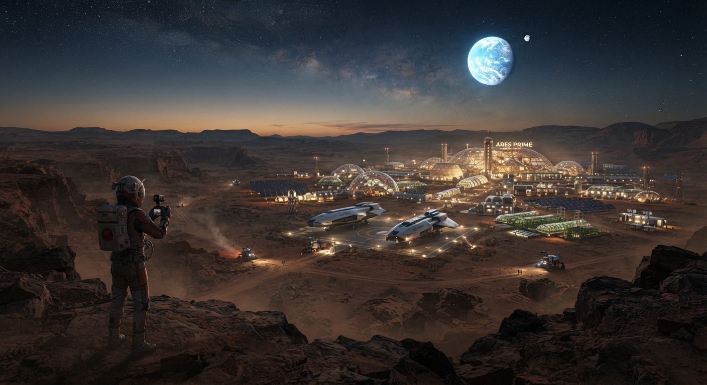

从地球生命的起源开始，演化让生物组织的层级不断提升，从细胞到多细胞生物，再到多细胞生物组成的社群。生物复杂性一直在持续提升。当然，演化过程中也有挫折，比如小行星撞击引发的大规模灭绝，但复杂化趋势一直不变，这些挫折只是暂时的，背后的动力极为强大，最终我们演化成了一个足够智慧的物种，这个物种能够分享思想，能够开启全新的计划，

假设有一群火星人，他们寿命比地球的寿命还长，在地球诞生之初就存在，他们有一个摄像机在地球诞生之初就对准地球拍摄。

现在这些火星人可以坐在沙发上，倒回录像带，将十亿年的地球历史压缩成两分钟。他们还可以在最后12000年切换为慢放，最初是荒芜的星球，随着植物的繁衍出现大量绿色，这些植物收集太阳能。

人类出现后，纤细的交流脉络开始萌发，文字出现，马车出现，城市城镇随之出现，对能感知信息的火星人来说，罗马帝国，古代中国等，看起来就像庞大的神经网络，这些区域性神经网络，通过贸易路线，越来越紧密的连接在一起。

对于身处其中的生物来说，比如三叠纪的恐龙和中世纪的农民，这个系统似乎没有明确的方向。单纯从火星人的视角来看，真个过程就像一个有机体的成熟，先形成躯体（生物圈），再发育出大脑，也就是生物圈和思想圈。它看起来就像不可避免的展开过程，就像花朵萌芽、生长、绽放的延时视频。

如果将地球生命演化视为成长过程，那么从生命原始种子到全球超级大脑的演进是注定的，是极有可能发生的，就像花朵生长与绽放一样，而现在人类正在通过AI加速演化。

